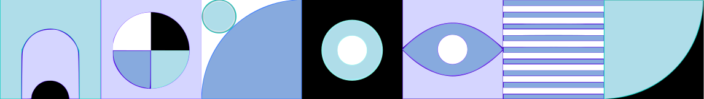

Informatique au gymnase : Travaux pratiques
===========================================

Bienvenue sur la plateforme de TP d'informatique !

.. toctree::
   :caption: Programmation (parcours formel)
   :maxdepth: 3
   :hidden:

   prog_formel/intro
   prog_formel/variables
   prog_formel/fonctions
   prog_formel/definitions
   prog_formel/conditions
   prog_formel/sequences
   prog_formel/liste
   prog_formel/algo

.. toctree::
    :name: Programmation (parcours dessin et aventure)
    :caption: Programmation (parcours dessin et aventure)
    :maxdepth: 3
    :hidden:

    prog_dessin/dessiner
    prog_dessin/definir
    prog_dessin/repeter
    prog_dessin/parametrer
    prog_dessin/parcourir
    prog_dessin/randomiser
    prog_dessin/aventure

`Programmation (parcours formel) <prog_formel/intro.html>`_
: ce chapitre contient le parcours d'apprentissage du langage python avec une approche formelle.

`Programmation (parcours dessin) <prog_dessin/dessiner.html>`_
: ce chapitre contient le parcours d'apprentissage du langage python avec une approche par le dessin (basé sur le contenu de Modulo).
